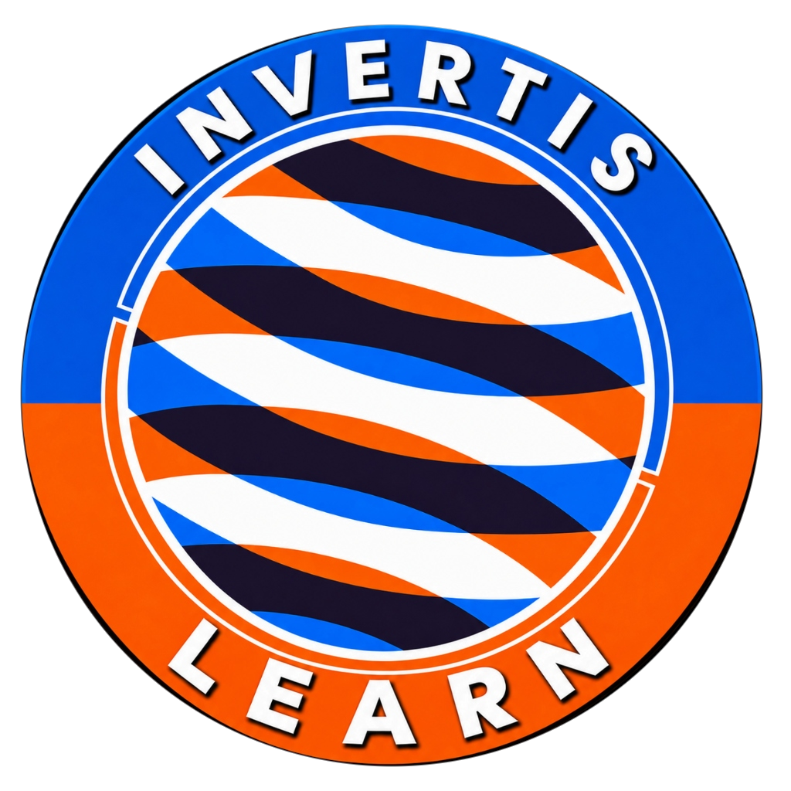

# Invertis Learn — Academic Learning and Curriculum Resource Platform

<p align="center">
  
</p>

<p align="center">
  <strong>Comprehensive Academic Companion, Verified Curriculum Library, and Resource Hub</strong><br>
  Built for students and faculty across Diploma, Undergraduate, Postgraduate, and Doctoral programmes.
</p>

<p align="center">
  
  
  
  
  
  
</p>

---

## Table of Contents

- [Overview](#overview)
- [Key Features](#key-features)
- [Technology Stack](#technology-stack)
- [Repository Structure](#repository-structure)
- [Prerequisites](#prerequisites)
- [Local Installation & Setup](#local-installation--setup)
- [Environment Configuration](#environment-configuration)
- [Developer & User Guide](#developer--user-guide)
- [Documentation Directory](#documentation-directory)
- [Security & Access Control](#security--access-control)
- [Deployment](#deployment)
- [Contributing](#contributing)
- [License](#license)
- [Academic Disclaimer](#academic-disclaimer)

---

## Overview

**Invertis Learn** is an academic companion web platform designed to streamline curriculum access, resource distribution, and exam preparation for engineering and computer science students at Invertis University, Bareilly.

The platform centralizes:
- **Curriculum & Syllabi**: Authenticated against university regulations and academic council ordinances.
- **Previous-Year Examination Papers (PYQs)**: Filterable by academic year, exam type (End-Sem, Mid-Sem, Back Paper), and semester.
- **Academic Materials**: Faculty lecture notes, formula sheets, and lab manuals.
- **Curated Multi-Media Learning**: Unit-mapped video lectures (NPTEL, MIT OCW, freeCodeCamp) and technical references.
- **Academic Career Roadmaps**: Structured guidance connecting course topics to real-world software engineering domains.

---

## Key Features

### 1. 4-Tier Academic Hierarchy
Organized under a standardized academic priority order across all search, catalog, and directory pages:
1. **Diploma Programmes** (e.g., Diploma in Computer Science & Engineering)
2. **Undergraduate (UG) Programmes** (e.g., B.Tech CSE Core, AI & ML, Cloud Computing)
3. **Postgraduate (PG) Programmes** (e.g., M.Tech Computer Science & Engineering)
4. **Doctoral (Ph.D.) Programmes** (Ph.D. in Computer Science & Engineering)

### 2. Standardized Lateral-Entry Support
- Integrated admission pathways displayed directly within eligible Diploma and Undergraduate programme cards.
- Accurate semester mappings (Semesters III–VIII for B.Tech lateral entry; Semesters I–II restricted).
- Dynamic credit and duration calculation (4 Years Regular vs. 3 Years Lateral).
- Permanent 301 redirection preserving legacy lateral entry URLs without breaking external bookmarks.

### 3. High-Reliability PDF Service & Source Provenance
- **100% Verified Physical PDFs**: 379/379 active subjects backed by validated on-disk PDF files extracted directly from university ordinances.
- **Canonical Parity**: "Open in Tab" (`inline=1`) and "Download PDF" (`name=...`) resolve through unified resource identifiers.
- **Tamper-Evident Tracking**: SHA-256 file checksums and official ordinance source references recorded in database provenance records.
- **Direct Streaming**: HTTP byte-range support (`206 Partial Content`) and RFC-compliant `filename*` UTF-8 attachment headers.

### 4. Comprehensive Resource Library
- **Previous Year Question Papers (PYQs)**: Categorized and searchable with solution indicators.
- **Lecture Notes & Lab Manuals**: Downloadable resources categorized by unit and resource type.
- **External Resources**: Verified links to NPTEL, GeeksforGeeks, and official documentation.
- **Curated Video Lectures**: Embedded YouTube playlists and topic lectures mapped to syllabus units.

### 5. Curator & Administrative Controls
- Built-in curator dashboard with HMAC-SHA256 signed session cookies.
- CSRF same-origin verification and bounded in-memory rate limiting.
- Administrative resource review, publication gating, and provenance verification workflows.

---

## Technology Stack

| Layer | Technologies | Purpose |
| :--- | :--- | :--- |
| **Frontend Framework** | [Next.js](https://nextjs.org/) `15.5.29` (App Router) | Server-side rendering (SSR), dynamic routing, API endpoints |
| **UI Library** | [React](https://react.dev/) `19.2.9` | Component architecture, React Server Components (RSC) |
| **Language** | [TypeScript](https://www.typescriptlang.org/) `5.6.3` | End-to-end type safety and strict schema validation |
| **Styling** | [Tailwind CSS](https://tailwindcss.com/) `3.4.14` | Utility-first styling with responsive, dark-mode-ready tokens |
| **Icons** | [Lucide React](https://lucide.dev/) `1.70.0` | Accessible, tree-shakeable SVG icons |
| **Database & ORM** | [Prisma ORM](https://www.prisma.io/) `5.21.1` & SQLite | Type-safe schema definition, relational queries, migrations |
| **PDF Processing** | [pdf-lib](https://pdf-lib.js.org/) `1.17.1` & `pdf-parse` `2.4.5` | Programmatic PDF extraction, page splitting, text inspection |
| **Validation** | [Zod](https://zod.dev/) `4.6.7` | Runtime request body and environment variable validation |
| **Testing** | [Playwright](https://playwright.dev/) `1.65.0` & ESLint `9.39.5` | End-to-end browser testing and static code analysis |

---

## Repository Structure

```
invertis-learn/
├── .github/                   # GitHub workflows, PR and issue templates
│   ├── ISSUE_TEMPLATE/        # Standardized issue templates
│   └── PULL_REQUEST_TEMPLATE.md
├── docs/                      # Architectural and technical documentation
│   ├── ARCHITECTURE.md        # System architecture, routing, component hierarchy
│   ├── DATABASE.md            # Schema models, relationships, backup procedures
│   ├── DEPLOYMENT.md          # Production hosting, persistence, and SSL guide
│   ├── FEATURES.md            # Complete feature catalog and implementation status
│   └── MAINTENANCE.md         # Operational runbooks and troubleshooting guides
├── prisma/                    # Database configuration and migrations
│   ├── dev.db                 # SQLite database file (excluded from git)
│   ├── migrations/            # Version-controlled migration history
│   └── schema.prisma          # Prisma schema definition
├── public/                    # Static public assets
│   ├── images/                # Brand logos, creator photography, SVG illustrations
│   └── uploads/               # Web-accessible uploaded PDFs and curriculum assets
├── scripts/                   # Administrative, migration, and verification scripts
│   ├── audit-pdf-reliability.cjs          # Audits 379 subjects against on-disk PDFs
│   ├── test-pdf-reliability-global.cjs    # E2E test verifying download/open routes
│   ├── extract-all-missing-syllabi.cjs    # Master ordinance PDF extraction pipeline
│   ├── backup.cjs                         # Database & storage backup script
│   └── restore-backup.cjs                 # Backup restoration runbook
├── src/
│   ├── app/                   # Next.js App Router pages and API routes
│   │   ├── (public)/          # Public-facing academic pages
│   │   ├── admin/             # Curator/admin dashboard
│   │   ├── api/               # API route handlers (/api/syllabus/download, /api/pyq)
│   │   ├── syllabus/          # Dynamic programme, semester, and subject views
│   │   └── error.tsx          # Application error boundaries
│   ├── components/            # Reusable UI and domain components
│   │   ├── common/            # Navbar, Footer, Breadcrumbs
│   │   ├── syllabus/          # SubjectSyllabusView, ModuleList, BookList
│   │   ├── pyq/               # PYQ cards, filters, and paper list
│   │   └── resources/         # External resources, video lectures, notes
│   ├── lib/                   # Shared utility modules
│   │   ├── access.ts          # HMAC session auth, CSRF, and rate limiting
│   │   ├── db.ts              # Global Prisma client singleton
│   │   ├── download.ts        # Byte-range PDF streaming service
│   │   ├── lateralEntry.ts    # Centralized lateral entry logic & validation
│   │   ├── pdf-resource-service.ts  # Canonical PDF resolution & checksums
│   │   └── private-storage.ts # Dual-root storage resolver
│   └── types/                 # Shared TypeScript interfaces
├── storage/                   # Private persistent storage (uploads outside public)
│   └── uploads/               # Private subject PDFs, notes, and lab manuals
├── .env.example               # Environment variable template
├── .gitignore                 # Strict Git exclusion list
├── next.config.mjs            # Next.js configuration, security headers, redirects
├── package.json               # Dependencies and npm scripts
├── tailwind.config.ts         # Tailwind CSS design tokens
└── tsconfig.json              # TypeScript compiler configuration
```

---

## Prerequisites

Before setting up the project locally, ensure you have installed:

- **Node.js**: `v22.14.0` or higher (compatible with Node 22.x and 24.x)
- **npm**: `v10.0.0` or higher
- **Git**: `v2.30.0` or higher
- **Operating System**: Windows 10/11, macOS, or modern Linux (Ubuntu 22.04+)

---

## Local Installation & Setup

### 1. Clone the Repository
```bash
git clone https://github.com/<your-username>/invertis-learn.git
cd invertis-learn
```

### 2. Install Dependencies
```bash
npm install
```
*(This automatically runs `npm run postinstall` which executes `prisma generate` to construct the Prisma Client).*

### 3. Configure Environment Variables
Copy `.env.example` to create your local `.env`:

On Linux/macOS:
```bash
cp .env.example .env
```
On Windows (PowerShell):
```powershell
Copy-Item .env.example .env
```

### 4. Initialize Database
Initialize the SQLite database and push the Prisma schema:
```bash
npm run db:push
```

*(Optional: Run catalogue seed if setting up from a blank database)*:
```bash
npm run db:seed
```

### 5. Generate Curator Authentication Key
Generate a cryptographically secure 64-character secret for curator access:
```bash
npm run curator:setup
```

### 6. Start Development Server
```bash
npm run dev
```
Open [http://localhost:3000](http://localhost:3000) in your browser.

---

## Environment Configuration

| Variable | Required | Default | Description |
| :--- | :---: | :--- | :--- |
| `DATABASE_URL` | **Yes** | `"file:./dev.db"` | Prisma connection string. Relative to `prisma/schema.prisma`. |
| `PRIVATE_STORAGE_PATH` | **Yes** | `"./storage/uploads"` | On-disk directory for private PDF storage and resource uploads. |
| `CURATOR_ACCESS_KEY` | **Yes** | `""` | Minimum 32-character secret key for signing curator cookies and authenticating admin APIs. |
| `APP_ORIGIN` | No | `""` (auto-detects) | Production browser origin (e.g., `https://invertislearn.com`) for strict CSRF validation. |
| `NODE_ENV` | No | `"development"` | Environment mode managed by Next.js (`development` vs `production`). |

---

## Developer & User Guide

### Running Quality Checks & Verification
```bash
# 1. TypeScript static typecheck (strict noEmit)
npm run typecheck

# 2. ESLint code standard review
npm run lint

# 3. Global PDF reliability audit (verifies all 379 subjects on disk)
node scripts/audit-pdf-reliability.cjs

# 4. Production build & verification
npm run build
npm start
```

### Navigating the Application
- **Explore Programmes**: Browse `/programmes` to access categorized Diploma, UG, PG, and Ph.D. degrees.
- **View Subject Syllabi**: Access `/syllabus/[programmeCode]/semester/[semNumber]/[subjectCode]` for interactive unit breakdowns, prescribed textbooks, and verified PDF actions.
- **Download PDFs**: Use the verified **"Open in Tab"** or **"Download PDF"** buttons. Both leverage `/api/syllabus/download?id=...` with byte-range streaming.
- **Access Career Pathways**: Visit `/career-pathways` for industry roadmaps connecting course topics to professional developer careers.
- **Curator Portal**: Access `/admin` using your configured `CURATOR_ACCESS_KEY` to inspect pending uploads and resource statuses.

---

## Documentation Directory

Comprehensive technical guides are available in the [`docs/`](file:///g:/invertis%20learn/docs) directory:

- [**System Architecture (`docs/ARCHITECTURE.md`)**](docs/ARCHITECTURE.md): Full breakdown of Next.js App Router, routing tables, Server Components, and data flow.
- [**Database & Storage (`docs/DATABASE.md`)**](docs/DATABASE.md): Prisma relational schema, model definitions, SQLite storage mechanics, and backup procedures.
- [**Deployment Guide (`docs/DEPLOYMENT.md`)**](docs/DEPLOYMENT.md): Production hosting options (VPS, Docker, Render, Railway), persistent volume requirements, Nginx, SSL, and CI/CD.
- [**Feature Specifications (`docs/FEATURES.md`)**](docs/FEATURES.md): Detailed verification status of all implemented features vs. future roadmap items.
- [**Maintenance Runbooks (`docs/MAINTENANCE.md`)**](docs/MAINTENANCE.md): Operational procedures for adding programmes, ingesting PDFs, and handling disaster recovery.

---

## Security & Access Control

1. **Zero Secret Exposure**: `.env` and `.env*.local` are strictly excluded from version control via `.gitignore`.
2. **Session Authentication**: Curator access uses HMAC-SHA256 tokens stored in `HttpOnly`, `SameSite=Lax` cookies with strict 8-hour expiration.
3. **CSRF & Origin Verification**: State-changing endpoints validate incoming `Origin` headers against `APP_ORIGIN`.
4. **Traversal Prevention**: Download endpoints validate real paths against `allowedStorageRoots()` to prevent directory traversal attacks (`../`).
5. **Rate Limiting**: Bounded in-memory sliding window rate limits prevent brute-force attempts on session and upload routes.

---

## Deployment

Invertis Learn requires a **persistent Node.js runtime** or a containerized environment with **persistent disk storage** to preserve SQLite database state and uploaded PDF files.

> [!IMPORTANT]
> Standard serverless platforms with ephemeral filesystems (e.g., standard Vercel or Netlify deploys) will discard local uploads and the SQLite database upon container recreation. For serverless deployments, external database hosting (PostgreSQL via Supabase/Neon) and cloud object storage (AWS S3 / Cloudflare R2) are required.
> 
> Refer to [**Deployment Guide (`docs/DEPLOYMENT.md`)**](docs/DEPLOYMENT.md) for step-by-step VPS (Docker/PM2), Railway, and Render deployment guides.

---

## Contributing

We welcome contributions to Invertis Learn! Please review [**CONTRIBUTING.md**](CONTRIBUTING.md) for coding conventions, branching guidelines, and pull request procedures.

---

## License

Copyright © 2024–2026 Amit Kumar Pal. All rights reserved.

This repository, its custom architecture, and platform code are proprietary to the author. Permission is granted to inspect and run local development instances for academic and educational evaluation. Commercial redistribution or unauthorized replication is prohibited.

---

## Academic Disclaimer

**Invertis Learn** is an independent, non-commercial academic companion platform developed by **Amit Kumar Pal** to assist university students with curriculum navigation and exam preparation.

- This website is **not officially operated, sponsored, or endorsed** by Invertis University administration.
- Course syllabus documents, evaluation schemes, and ordinances are transcribed or archived from publicly available university regulations for educational reference under fair use.
- Students are strongly advised to verify final examination schedules, regulatory amendments, and official notices directly with their respective academic departments and university administrative offices.

