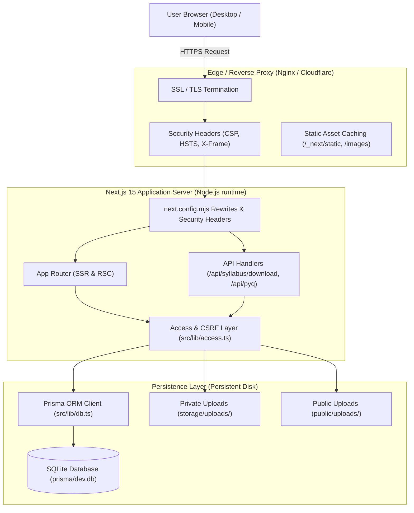
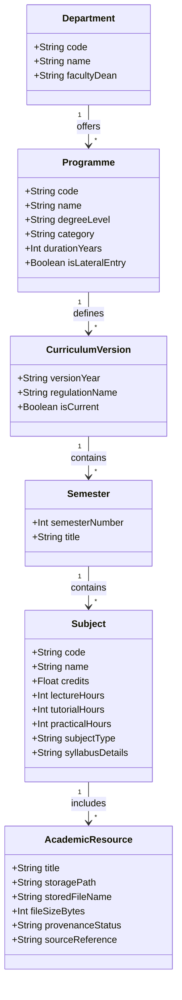
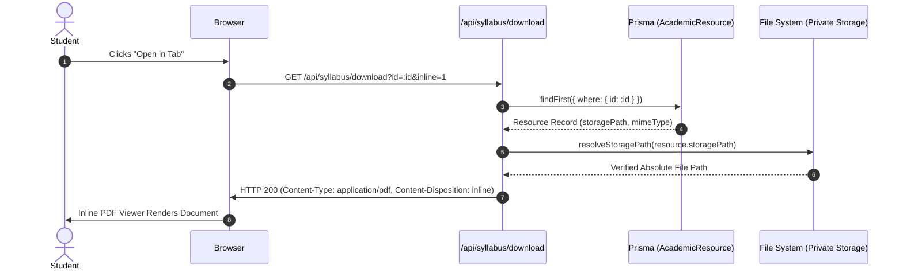
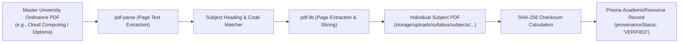

# Invertis Learn — System Architecture & Technical Design

## 1. Architectural Overview

**Invertis Learn** is architected as a modern full-stack web application utilizing the **Next.js 15 App Router**, **React 19 Server Components**, **TypeScript**, and **Prisma ORM** with **SQLite**.

The system balances server-side rendering for search engine accessibility, rapid initial load performance, and static asset streaming with client-side interactivity for filtering, search, and dynamic document interactions.

---

## 2. Frontend Architecture

### 2.1 React 19 Server Components (RSC)
By default, all pages within `src/app/` are React Server Components. RSCs execute exclusively on the server, offering key architectural advantages:
- **Zero Client Bundle for Data Logic**: Heavy parsing libraries (such as database access logic or JSON processing) are never transmitted to the browser.
- **Direct Database Access**: Pages query the Prisma database directly during SSR without making intermediate HTTP fetch requests to internal API routes.
- **Fast First Contentful Paint (FCP)**: The server streams pre-rendered HTML to the client, providing immediate visibility and SEO readability.

### 2.2 Client Components (`"use client"`)
Client components are strategically isolated to leaf nodes where browser APIs, state hooks, or DOM event handlers are necessary:
- `SubjectSyllabusView.tsx`: Manages interactive unit accordion expansions and download triggers.
- `Breadcrumbs.tsx`: Client-side breadcrumb navigation.
- `Navbar.tsx` & `MobileDrawer.tsx`: Responsive navigation toggle, mobile menus, and theme preservation.
- `SearchBox.tsx`: Real-time debounced query filtering.

### 2.3 Styling & Design System
- Built on **Tailwind CSS 3.4.14** with utility classes and CSS variables.
- Design tokens incorporate Invertis brand blues (`#1e40af`, `#2563eb`), slate neutrals, emerald verification indicators, and amber alert cues.
- Mobile-first responsive grids (`grid-cols-1 md:grid-cols-2 lg:grid-cols-3`).

---

## 3. Backend & API Architecture

### 3.1 Routing Table

| Route Path | Type | Purpose | Cache / Rendering |
| :--- | :---: | :--- | :--- |
| `/` | SSR | Homepage with hero, academic tiers, feature highlights | Dynamic (SSR) |
| `/programmes` | SSR | Master catalogue of all academic programmes | Dynamic (SSR) |
| `/programmes/[programmeCode]` | SSR | Programme details, eligibility, duration, semester hubs | Dynamic (SSR) |
| `/syllabus/[programmeCode]` | SSR | Programme syllabus overview with lateral entry pathways | Dynamic (SSR) |
| `/syllabus/[prog]/semester/[sem]` | SSR | Semester subject listing with credit totals | Dynamic (SSR) |
| `/syllabus/[prog]/semester/[sem]/[code]` | SSR | Full subject syllabus, unit modules, textbook list, PDF card | Dynamic (SSR) |
| `/pyq` | SSR | Previous-year questions hub with programme selector | ISR (1 hour) |
| `/notes` | SSR | Faculty notes and formula sheets hub | ISR (1 hour) |
| `/labs` | SSR | Lab manuals and experiment viva guides | ISR (1 hour) |
| `/career-pathways` | SSR | Industry career roadmaps mapped to academic subjects | ISR (1 hour) |
| `/about` | Static | Platform mission, architecture, and creator profile | Static |
| `/search` | SSR | Global search across programmes, subjects, and topics | Dynamic (SSR) |
| `/admin` | SSR | Curator dashboard for review and resource ingestion | Dynamic (SSR) |
| `/api/syllabus/download` | API | Unified endpoint for inline PDF viewing and downloading | Dynamic API |
| `/api/pyq/download` | API | Download endpoint for previous-year exam papers | Dynamic API |
| `/api/admin/session` | API | Curator authentication and session generation | Dynamic API |
| `/api/health` | API | Health check returning status 200 and system uptime | Dynamic API |

---

## 4. Academic Data Hierarchy & Normalization

The academic catalogue is modeled across four hierarchical tiers:

### 4.1 Academic Level Sorting
All programme listings, homepage grids, and dropdown filters follow a standardized sort order managed centrally via [`src/lib/academicLevels.ts`](file:///g:/invertis%20learn/src/lib/academicLevels.ts):

$$\text{Priority: } \text{Diploma } (1) \longrightarrow \text{Undergraduate } (2) \longrightarrow \text{Postgraduate } (3) \longrightarrow \text{Doctoral } (4)$$

---

## 5. Lateral Entry Integration Architecture

To avoid duplicating curriculum records between regular 4-year and lateral-entry 3-year programmes:

1. **Centralized Logic ([`src/lib/lateralEntry.ts`](file:///g:/invertis%20learn/src/lib/lateralEntry.ts))**:
   - `isLateralEntryProgramme(code)`: Detects lateral aliases.
   - `getParentProgrammeCode(code)`: Resolves lateral identifiers back to the core curriculum owner (e.g. `BTECH-CSE-LE` $\rightarrow$ `BTECH-CSE`).
   - `isSemesterAllowedForProgramme(code, sem)`: Strictly restricts Semesters I & II for lateral entry candidates.
2. **Dynamic Badging & Duration**:
   - Undergraduate course cards display both admission pathways: **4 Years Regular / 3 Years Lateral**.
   - Subjects for Semesters III through VIII are dynamically re-used from the primary curriculum.
3. **HTTP 301 Consolidation**:
   - `next.config.mjs` enforces permanent 301 redirects from old lateral routes (e.g. `/syllabus/BTECH-CSE-LE`) to query parameters (`/syllabus/BTECH-CSE?entry=lateral`).

---

## 6. PDF Storage & Resource Resolution

### 6.1 Dual-Root Storage Model
Syllabus and academic resource files are stored on disk across two coordinated roots managed by [`src/lib/private-storage.ts`](file:///g:/invertis%20learn/src/lib/private-storage.ts):
- Primary Root: `storage/uploads/` (Private directory outside web root).
- Secondary Root: `public/uploads/` (Public fallback directory).

`resolveStoragePath(storagePath)` inspects both directories, resolving relative database keys to absolute physical paths while preventing directory traversal attacks.

### 6.2 HTTP Streaming & Range Requests
The resource delivery handler in [`src/lib/download.ts`](file:///g:/invertis%20learn/src/lib/download.ts) supports standard HTTP range requests (`Accept-Ranges: bytes`):
- Enables instant rendering of multi-page PDFs without waiting for the full file to download.
- Responds with `206 Partial Content` for requested byte chunks.
- Injects strict security headers: `X-Content-Type-Options: nosniff` and sanitized `filename*=UTF-8''...` attachment metadata.

---

## 7. Syllabus Ingestion & Verification Pipeline

Master curriculum ordinances provided by Invertis University are ingested using automated Node.js pipelines (`scripts/extract-all-missing-syllabi.cjs`):

---

## 8. Security Architecture

1. **Authentication ([`src/lib/access.ts`](file:///g:/invertis%20learn/src/lib/access.ts))**:
   - Curator sessions rely on HMAC-SHA256 signatures (`expires.signature`) stored in `HttpOnly` cookies.
   - Enforces a minimum 32-character secret length (`CURATOR_ACCESS_KEY`).
   - Constant-time signature comparison using `crypto.timingSafeEqual` mitigates timing attacks.
2. **CSRF Protection**:
   - All mutating API calls (`POST`, `PATCH`, `DELETE`) validate the incoming `Origin` header against `APP_ORIGIN` via `sameOrigin()`.
3. **Directory Traversal Defense**:
   - Every file download resolves through `fs.realpath` and validates that the resolved path begins with an authorized storage root from `allowedStorageRoots()`.
4. **Rate Limiting**:
   - In-memory sliding window bucket limiter (`allowAttempt`) blocks brute-force authentication attacks on `/api/admin/session`.

