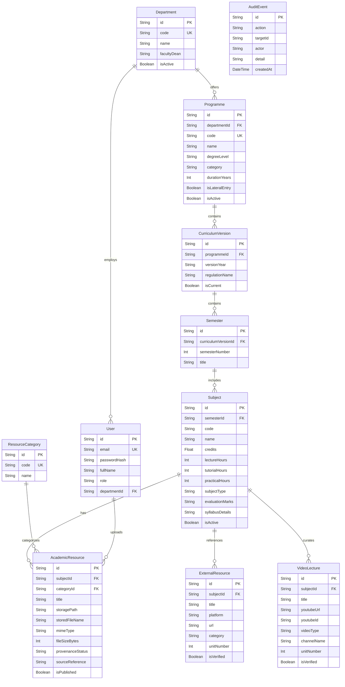

# Invertis Learn — Database Architecture & Storage Documentation

## 1. Database Overview

**Invertis Learn** utilizes **Prisma ORM (v5.21.1)** with **SQLite** (`prisma/dev.db`) for structured data persistence.

SQLite provides an efficient, self-contained, zero-configuration database well-suited for single-instance web applications and academic resource indexing. For high-concurrency production deployments requiring horizontal scaling, Prisma's declarative schema allows seamless migration to **PostgreSQL** or **MySQL**.

---

## 2. Entity-Relationship Diagram (ERD)



---

## 3. Schema Models & Data Dictionary

### 3.1 `Department`
Represents an academic faculty or departmental body.
- `id` (String, PK): Unique CUID identifier.
- `code` (String, Unique): Department code (e.g., `ENG`, `CA`, `MGMT`).
- `name` (String): Full name (e.g., `Faculty of Engineering & Technology`).
- `facultyDean` (String, Optional): Dean or department head name.
- `isActive` (Boolean): Soft-delete flag (default `true`).

### 3.2 `Programme`
Represents an academic degree or diploma offering.
- `id` (String, PK): Unique CUID identifier.
- `departmentId` (String, FK $\rightarrow$ Department.id): Cascade delete.
- `code` (String, Unique): Official programme code (e.g., `BTECH-CSE`, `MTECH-CSE`, `DIP-CSE`, `PHD-009`).
- `name` (String): Full academic title.
- `degreeLevel` (String): Standardized level: `DIPLOMA`, `UNDERGRADUATE`, `POSTGRADUATE`, `DOCTORAL`.
- `category` (String): Category grouping matching `degreeLevel`.
- `durationYears` (Int): Standard curriculum duration in years (e.g., 3, 4, 2).
- `eligibility` (String, Optional): University admission criteria.
- `isLateralEntry` (Boolean): Flag indicating if programme is a lateral entry pathway.

### 3.3 `CurriculumVersion`
Captures regulatory syllabus schemes and ordinances.
- `id` (String, PK): Unique CUID identifier.
- `programmeId` (String, FK $\rightarrow$ Programme.id): Cascade delete.
- `versionYear` (String): Academic session (e.g., `2023-2024`).
- `regulationName` (String, Optional): Ordinance title (e.g., `Regulation 2023-24`).
- `isCurrent` (Boolean): Active regulation scheme indicator.
- **Constraints**: Unique constraint on `[programmeId, versionYear]`.

### 3.4 `Semester`
Represents academic semesters (Semesters 1 through 8).
- `id` (String, PK): Unique CUID identifier.
- `curriculumVersionId` (String, FK $\rightarrow$ CurriculumVersion.id): Cascade delete.
- `semesterNumber` (Int): Integer 1 to 8.
- `title` (String): Display title (e.g., `Semester I`, `Semester III`).
- **Constraints**: Unique constraint on `[curriculumVersionId, semesterNumber]`.

### 3.5 `Subject`
Represents individual courses within a semester.
- `id` (String, PK): Unique CUID identifier.
- `semesterId` (String, FK $\rightarrow$ Semester.id): Cascade delete.
- `code` (String): Course code (e.g., `BCS-301`, `DAS101`, `BCSI101`).
- `name` (String): Subject title (e.g., `Data Structures`, `Mathematics-I`).
- `credits` (Float): Academic credits (default `3.0`).
- `lectureHours`, `tutorialHours`, `practicalHours` (Int): Weekly contact hours.
- `subjectType` (String): Classification: `THEORY`, `PRACTICAL`, `PROJECT`, `SEMINAR`, `MANDATORY`.
- `evaluationMarks` (String, Optional): Breakdown (e.g., `CA: 25, EE: 50, Total: 75`).
- `syllabusDetails` (String, JSON): Serialized JSON object containing:
  - `objectives`: Array of course objectives.
  - `outcomes`: Array of course outcomes (COs).
  - `modules`: Array of `{ title, topics }`.
  - `textBooks`: Prescribed textbook bibliography.
  - `referenceBooks`: Recommended reference books.
- **Constraints**: Unique constraint on `[semesterId, code]`.

### 3.6 `AcademicResource`
Stores uploaded files and document metadata.
- `id` (String, PK): Unique CUID identifier.
- `subjectId` (String, FK $\rightarrow$ Subject.id): Cascade delete.
- `categoryId` (String, FK $\rightarrow$ ResourceCategory.id): Restrict delete.
- `title` (String): Display title.
- `storagePath` (String): Path relative to storage roots (`uploads/syllabus/subjects/...`).
- `storedFileName` (String): Actual file name on disk.
- `mimeType` (String): MIME type (default `application/pdf`).
- `fileSizeBytes` (Int): Exact file size in bytes.
- `provenanceStatus` (String): Verification status: `VERIFIED`, `UNVERIFIED`, `PRACTICE`.
- `sourceReference` (String, Optional): University regulation or ordinance citation.
- `isPublished` (Boolean): Public visibility toggle (default `true`).
- **Indices**: Indexed by `[subjectId, categoryId]`, `[categoryId, academicYear]`.

### 3.7 `ExternalResource` & `VideoLecture`
Curated educational materials linked to subjects.
- `ExternalResource`: Platform (NPTEL, GeeksforGeeks, MDN), URL, category, unit mapping.
- `VideoLecture`: YouTube URL, YouTube ID, channel name, video/playlist type, unit mapping.

---

## 4. File Storage References & Provenance Tracking

PDF files are physically separated from the database to preserve database performance:
1. **Database Record**: Stores `storagePath`, `storedFileName`, byte size, and `provenanceStatus`.
2. **File System**: Binary PDF stored under `storage/uploads/` or `public/uploads/`.
3. **Parity Check**: Before delivering any document, `checkPhysicalPdfAvailability` confirms:
   - File exists at the resolved path.
   - File size matches `AcademicResource.fileSizeBytes`.
   - File begins with valid PDF magic bytes (`%PDF-`).

---

## 5. Migrations & Database Operations

### 5.1 Prisma Migration Commands
```bash
# Push schema changes directly to SQLite database (development)
npm run db:push

# Generate typed Prisma Client after schema edits
npm run postinstall

# Deploy pending migrations (production)
npm run db:migrate
```

### 5.2 Backup and Recovery Procedures
A dedicated backup script is provided in [`scripts/backup.cjs`](file:///g:/invertis%20learn/scripts/backup.cjs):

```bash
# Create an automated snapshot of database and storage
npm run db:backup
```
- Snapshots `prisma/dev.db` into `backups/db/dev-<timestamp>.db`.
- Archives `storage/uploads/` into `backups/storage/storage-<timestamp>.tar.gz`.

To restore from a backup:
```bash
# Run restoration runbook
npm run db:restore
```

---

## 6. Migration Guide: SQLite to PostgreSQL

For multi-instance or serverless deployments requiring concurrent writes:

1. **Update `prisma/schema.prisma`**:
   ```prisma
   datasource db {
     provider = "postgresql"
     url      = env("DATABASE_URL")
   }
   ```
2. **Update `.env`**:
   ```ini
   DATABASE_URL="postgresql://<username>:<password>@<host>:5432/invertislearn?sslmode=require"
   ```
3. **Deploy Migrations**:
   ```bash
   npx prisma migrate dev --name init_postgresql
   npx prisma db push
   ```
4. **Seed Catalogue**:
   ```bash
   npm run db:seed
   ```

