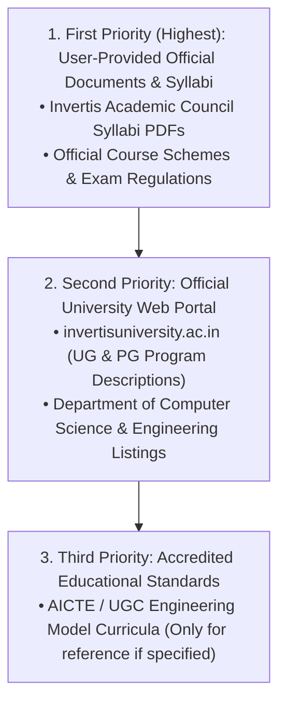

# Invertis Learn — Official University Reference Sources & Integrity Policy

**Institution:** Invertis University, Bareilly, Uttar Pradesh  
**Faculty:** Faculty of Engineering & Technology  
**Department:** Department of Computer Science & Engineering  
**Primary Institutional Portal:** [https://www.invertisuniversity.ac.in](https://www.invertisuniversity.ac.in)  
**UG Programmes Reference:** [https://www.invertisuniversity.ac.in/ug-programmes](https://www.invertisuniversity.ac.in/ug-programmes)  
**PG Programmes Reference:** [https://www.invertisuniversity.ac.in/pg-programmes](https://www.invertisuniversity.ac.in/pg-programmes)  

---

## 1. Source Hierarchy & Precedence Rules

Whenever developing any course, subject, semester, or academic module on Invertis Learn, Antigravity adheres to the strict 3-tier source hierarchy:

1. **First Priority — User-Provided Official Documents:**
   - Invertis University Academic Council Syllabus PDFs (`BTech_Year1_Common_Syllabus_2023-24.pdf`, `BTech_CSE_Year2_Syllabus_2023-24.pdf`, etc.).
   - All subject codes, titles, credits, lecture/tutorial/practical hours, course objectives (CO1–CO5), outcomes, module units, and recommended textbooks are extracted verbatim from these documents.
   - **Never overwrite or contradict user-provided syllabi** with secondary web data.

2. **Second Priority — Official University Web Portal:**
   - [Invertis University UG Programmes](https://www.invertisuniversity.ac.in/ug-programmes)
   - [Invertis University PG Programmes](https://www.invertisuniversity.ac.in/pg-programmes)
   - Used to confirm programme names, degree levels, durations, institutional affiliations, and specializations (e.g. AI, Cloud Computing, IoT).

3. **Third Priority — Accredited Educational Standards:**
   - Consulted only when explicitly permitted or when general pedagogical classification is required.

---

## 2. Mandatory Accuracy & Data Integrity Principles

1. **Zero Invented Academic Data:**
   - Never invent syllabus topics, subject names, semester structures, question papers, or examination details.
   - Do not assume that rules or course codes from other universities (e.g. AKTU, VTU) apply to Invertis University.

2. **Strict Handling of Unavailable Information:**
   - If official metadata (such as reference books or examination rubrics) is not specified in the university source, clearly mark the section as **"Not Specified in Official Curriculum"** or omit the empty block.
   - Never create misleading placeholder documents or broken download links.

3. **Preservation of Official Terminology:**
   - Maintain official course nomenclature, course numbering schemes (e.g., `BCS-301`, `MCS-101`), and evaluation terms (Continuous Assessment `CA`, End-Semester Examination `EE`, Sessional Marks).

4. **Scope Control & Phased Discipline:**
   - The reference website is an **academic reference source**, not authorization to expand the project scope or introduce future phases prematurely.
   - Development follows the step-by-step roadmap strictly: complete and verify one phase before requesting permission to start the next.

